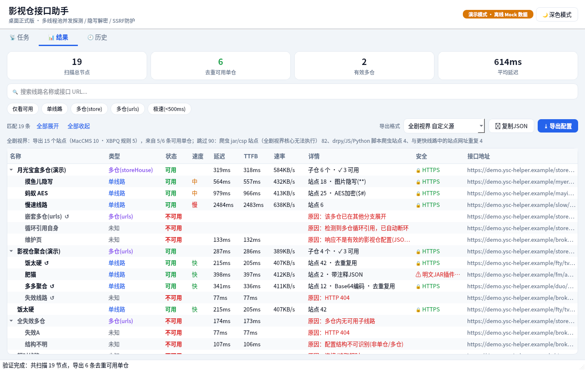

# 影视仓接口助手 · PySide6 桌面版

本项目把 Android 原生版 [ysc-helper-android](https://github.com/yz8023/ysc-helper-android)（Kotlin + Jetpack Compose）
完整移植为 **Python + PySide6（Qt 6）桌面 GUI 应用**，可在 Windows / macOS / Linux 上运行，并可用 PyInstaller 打包成 exe。



> 截图为 `--demo` 演示模式（离线 Mock 数据）下的扫描结果，真实的探测引擎、解析器和安全校验都会完整运行。深色主题见 `screenshot_dark.png`。

---

## 一、功能

| 模块 | 说明 |
| --- | --- |
| **种子源 / 聚合页爬取** | 内置 47 条基础线路 + 15 个聚合页；聚合页 HTML 用预编译正则提取候选接口 URL（过滤图片 / 脚本 / 无关站点，`&amp;` 还原） |
| **多线程递归探测引擎** | 支持单仓（`spider`/`sites`/`lives`/`parses`）与多仓（`storeHouse` / `urls`）递归展开，最大深度 3，每个多仓最多 100 个子仓；**并发 4~32 可调** |
| **无死锁 + Single-Flight** | 网络线程只做 I/O + 解析，从不阻塞等待子任务（续体回调组装父节点），即使并发设为 4、嵌套很深也不会线程饥饿死锁；相同 URL 全局只请求 1 次，所有引用方共享真实测速结果；自动断开 A→B→A 循环引用 |
| **测速** | TTFB（响应头到达）+ 总耗时 + 速率；可选 1/2/3 次采样取中位数；按「快 <500ms / 中 <2000ms / 慢」分级 |
| **一键取消** | 停止按钮立即中断全部工作线程任务并关闭在途 HTTP 连接 |
| **全格式解码**（`TvBoxPayloadParser`） | 标准 JSON；词法状态机剥离 `//`、`/* */` 注释与尾随逗号（不会破坏字符串里的 `http://`）；图片隐写（文件末尾 `**` + Base64）；纯 Base64（含 URL-safe）；CatVod `2423`（`$#key#$密文+IV`）AES-128-CBC 解密，兼容 13 位时间戳 IV 与 16 字节 IV |
| **URL 安全校验 / SSRF 防护** | 拦截回环、私网、链路本地（含云元数据 169.254.169.254）、CGNAT 100.64/10、组播 / 保留地址、IPv4-mapped IPv6、`localhost` / `.local` / `.lan` 等；禁止 `user@host` 伪装；中文域名 IDN → Punycode；**连接层安全 DNS**（解析后逐个校验 IP 并直连已校验 IP，防 DNS Rebinding）；每一跳 30x 重定向都重新校验；响应体（解压后）硬上限 **4 MB**（防 Gzip 炸弹） |
| **风险提示** | 明文 `http://` 接口、明文 `spider` JAR 插件显式标注；「严格仅允许 HTTPS」开关 |
| **结果树** | 树形展示多仓 / 子仓，展开 / 收起 / 全部展开 / 全部收起；**180ms 防抖**搜索；仅看可用 / 单线路 / 多仓(store) / 多仓(urls) / 极速 筛选（子仓命中时自动保留并展开父多仓）；状态、速度、延迟、TTFB、速率、站点数、格式、安全列；右键 / Ctrl+C 复制接口地址 |
| **导出** | 去重（剥离 GitHub 代理前缀后按规范化 URL 去重）+ 按延迟升序生成配置；**导出到文件**或**复制 JSON 到剪贴板**。两种格式可选：**影视仓 / TVBox 多仓** `{"urls":[...]}`，或 **全剧视界 自定义源** `{"format":"duanju-custom-sources",...}`（见下文） |
| **历史** | SQLite 索引表 + GZIP 压缩结果树快照，最多保留 20 份，可恢复 / 删除；启动时自动恢复最近一次结果 |
| **自定义接口源** | 添加 / 删除自定义线路（支持中文域名），可「仅验证自定义源」或「添加并立即测速」 |
| **主题** | 浅色 / 深色一键切换（默认跟随系统，选择会被记住） |

## 二、安装

需要 **Python 3.9+**（推荐 3.11 ~ 3.13）。

```bash
cd ysc-helper-pyside6
python -m venv .venv

# Windows
.venv\Scripts\activate
# macOS / Linux
source .venv/bin/activate

pip install -r requirements.txt          # 运行依赖：PySide6-Essentials、requests、cryptography
pip install -r requirements-dev.txt      # 可选：测试与打包（pytest、pyinstaller）
```

> 国内网络可加镜像：`pip install -r requirements.txt -i https://pypi.tuna.tsinghua.edu.cn/simple`

## 三、运行

```bash
python main.py              # 正常启动（真实网络）
python main.py --demo       # 离线演示模式：内置 Mock 数据（含隐写 / AES / Base64 / 注释 JSON / 循环引用 / 失效线路）
python main.py --dark       # 强制深色主题（--light 强制浅色）
python main.py --data-dir D:\ysc-data    # 自定义数据目录
```

使用流程：

1. 「任务」页调整并发线程数（4~32）、采样次数、是否仅允许 HTTPS；
2. 点击 **全网搜寻与多线程极速验证**（或在「自定义接口源」中添加自己的线路后点 **仅验证自定义源**）；
3. 完成后自动切换到「结果」页：搜索 / 筛选 / 展开查看；在 **导出格式** 下拉框选择
   「影视仓 / TVBox 多仓」或「全剧视界 自定义源」，再点 **导出配置**（保存文件）或 **复制JSON**（剪贴板）。

数据默认保存在：Windows `%APPDATA%\YscHelper\`，macOS / Linux `~/.local/share/ysc-helper/`
（`ysc_helper.db` 历史索引、`snapshots/*.json.gz` 结果快照、`settings.json` 设置与自定义源）。也可用环境变量 `YSC_HELPER_DATA_DIR` 指定。

### 使用 Clash / 代理 TUN 模式时

Clash、Surge 等代理开启 **Fake-IP / TUN** 模式后，所有域名都会解析到 `198.18.x.x`。该网段默认按保留地址拦截（与 Android 版一致），
此时所有线路都会显示「解析为代理 Fake-IP」。请在「任务 → 多线程并发与安全参数」里勾选 **兼容代理 Fake-IP 模式**
（只放行域名解析得到的 198.18.0.0/15，直接写成 IP 的地址仍然拦截）。

### 导出到「全剧视界」

「全剧视界」是「短剧视界」的全源版（同一 Go 核心，`--all-sources` 构建），它的「自定义源 → 导入（文件 / 网络地址）」
接受下面这种 JSON（与它自己「导出 JSON」得到的文件同格式）：

```json
{
  "format": "duanju-custom-sources",
  "version": 1,
  "count": 2,
  "sites": [
    { "name": "某某资源采集", "url": "https://cj.example.com/api.php/provide/vod" },
    { "name": "某某影视", "url": "https://www.example.com",
      "rule": { "主页url": "https://www.example.com/", "分类url": "https://www.example.com/show/{cateId}-{catePg}.html", "数组": "<li&&</li>" } }
  ]
}
```

格式依据（全剧视界开源仓库，非猜测）：
[`native/core/provider_custom_maccms.go`](https://github.com/wokaotianshi123/guoappxxx/blob/main/native/core/provider_custom_maccms.go)
（`exportCustomMaccmsSources` / `customSourceDrafts` / `customMaccmsRegistry.add`）与其测试
[`provider_custom_import_test.go`](https://github.com/wokaotianshi123/guoappxxx/blob/main/native/core/provider_custom_import_test.go)。

**怎么转换的**：全剧视界导入的是「站点」，不是 TVBox「线路仓库」，并且它的 Go 核心**不能运行 jar / JS 爬虫**。
所以本工具在检测时就记录每条可用单仓 `sites` 里能导入的站点，导出时按线路延迟从快到慢展开：

| TVBox 站点 | 全剧视界条目 |
| --- | --- |
| `type` 0 / 1（或缺省）且 `api` 为 http(s) 的 MacCMS 采集接口 | `{"name","url"}`：含 `/api.php` 或 `/provide/vod` 的端点保留完整路径（去掉 `?ac=list` 之类参数与结尾 `/`），其他地址收敛为站点根 |
| `ext` 是内联 XBPQ 规则对象（含「主页url / 分类url / 数组 …」） | `{"name","url":主页url,"rule":{规则对象}}` |
| `api` 为 `csp_XBPQ`、`ext` 是规则文件地址（如 `./xbpq/a.json`） | 导出时按线路地址解析相对路径并抓取（同样经过 SSRF 防护），成功后同上 |
| `type` 3 jar/csp 爬虫、drpy/JS/Python 脚本、`type` 4 远程接口 | **跳过**（全剧视界导入时也会提示「爬虫(jar)规则无法在核心内执行」） |

同时遵守全剧视界导入端的限制：名称去表情符号、不超过 40 字；网址必须 http/https、域名含「.」、不带参数/锚点/用户名；
按网址（不区分大小写）全局去重（重复时保留更快线路中的那条）；单次最多 200 条；整个自定义源存储上限 256KB
（本工具按约 200KB 预算截断规则站点，给你已有的自定义源留余量）。`type` 字段留空 = 全剧视界「自动识别」，
不强制 `json`，以免探测失败时没有网页模板兜底。

导出后在结果页下方会显示统计，例如「导出 15 个站点（MacCMS 10 · XBPQ 规则 5）…；跳过 90：爬虫 jar/csp 站点 82、…」。
导入方式：全剧视界 → 自定义源 → 导入 → 文件，选择保存的 `duanju-custom-sources-日期.json`。

## 四、测试

```bash
pip install -r requirements-dev.txt
python -m pytest -q
```

测试覆盖：解析器（注释 / 尾逗号 / 字符串保护 / 隐写 / Base64 / AES 两种 IV / 异常输入）、URL 安全校验（规范化、IDN、代理清洗、
SSRF 各网段、非法 URL、仅 HTTPS、DNS 重绑定、Fake-IP）、HTTP 客户端（4MB 上限、Gzip 炸弹、重定向到内网 / file:// 拦截、HTTP 状态码）、
探测引擎（Single-Flight、断环、空多仓、深度上限、取消、并发 4 深嵌套无死锁）、历史仓库与树形筛选、
全剧视界导出（用全剧视界仓库自带测试用例的输入验证：jar 跳过、端点保留、规则主页、名称规整、去重、200 条 / 256KB 上限、
外链规则抓取、旧快照兼容）以及结果页格式切换后的复制 / 保存。

可选：用**全剧视界真实的 Go 导入代码**做端到端校验（需要 Go 1.25+）：

```bash
git clone --depth 1 https://github.com/wokaotianshi123/guoappxxx /tmp/guoappxxx
QUANJU_CORE_DIR=/tmp/guoappxxx/native python -m pytest -q tests/test_quanju_export.py
```

该用例把 `tools/quanju_import_check/ysc_import_check_test.go` 临时放进其 `native/core/`，调用 `importCustomMaccmsSources`
导入本工具的导出文件，断言 0 失败、0 跳过、全部落盘且名称/网址与 Go 规整结果一致。

无界面环境下也可以启动（例如 CI）：

```bash
QT_QPA_PLATFORM=offscreen python main.py --screenshot shot.png   # 自动跑演示扫描并截图后退出
```

## 五、打包为 exe（PyInstaller）

**需要在目标系统上打包**（Windows exe 要在 Windows 上打，macOS app 要在 macOS 上打）。

```bash
pip install pyinstaller

# 方式一：使用项目自带 spec（目录模式，启动快，已排除未使用的大体积 Qt 模块）
pyinstaller --noconfirm ysc_helper.spec
# 产物：dist/YscHelper/YscHelper.exe（把整个 dist/YscHelper 目录分发即可）

# 方式二：单文件 exe（体积更大，首次启动需解压，稍慢）
pyinstaller --noconfirm --onefile --windowed --name YscHelper main.py
# 产物：dist/YscHelper.exe
```

可选：加 `--icon app.ico` 指定图标。若杀毒软件误报单文件 exe，建议使用方式一（目录模式）。

## 六、目录结构

```text
ysc-helper-pyside6/
├── main.py                         # 入口
├── requirements.txt / requirements-dev.txt
├── ysc_helper.spec                 # PyInstaller 打包配置
├── ysc_helper/
│   ├── app.py                      # 应用装配、命令行参数
│   ├── models.py                   # 领域模型（RepoNode / 统计 / 设置等）
│   ├── tree_filter.py              # 正确的父子树形过滤
│   ├── demo.py                     # 离线演示 Mock 传输与示例数据
│   ├── parser/tvbox_payload_parser.py      # JSON / 注释 / 隐写 / Base64 / AES 解码器
│   ├── security/url_security_validator.py  # URL 规范化、IDN、代理清洗、SSRF 校验
│   ├── network/
│   │   ├── probe_http_client.py    # 流式限流客户端（TTFB、4MB、重定向校验、取消）
│   │   └── safe_transport.py       # 防 DNS Rebinding 的 urllib3 连接层
│   ├── engine/
│   │   ├── probe_engine.py         # 多线程递归探测 + Single-Flight + 导出
│   │   ├── thread_pool_manager.py  # 爬虫 / 探测 IO / CPU 解析 三层线程池 + 遥测
│   │   ├── html_url_extractor.py   # 聚合页 URL 提取
│   │   └── source_seed_provider.py # 内置种子与聚合页
│   ├── export/quanju.py            # 全剧视界自定义源导出（复刻其导入规则）
│   ├── data/repository.py          # SQLite + GZIP 快照 + settings.json
│   └── ui/                         # PySide6 界面：主窗口、任务 / 结果 / 历史页、主题、控制器
├── tools/quanju_import_check/      # 用全剧视界 Go 核心校验导出文件的测试桩
└── tests/                          # pytest 单元测试
```

## 七、与 Android 版的差异

* **WorkManager 后台巡检** → 移除（桌面程序窗口关闭即结束；最小化时扫描照常进行）。
* **Android SAF 文件导出** → 系统「另存为」对话框（`QFileDialog`）；剪贴板改用 `QClipboard`。
* **Room / DataStore** → 标准库 `sqlite3` + `settings.json`；快照文件名追加随机后缀，避免同一毫秒内重名覆盖。
* **OkHttp** → `requests` + 自定义 urllib3 连接类（安全 DNS），手动逐跳跟随重定向并校验；每主机连接池 6。
* **协程 + Semaphore** → `ThreadPoolExecutor` + `Future` 续体回调。探测池大小即全局 HTTP 并发上限；
  Python 线程池不能运行时扩缩容，所以并发设置在**下一次开始扫描时**生效。
* **新增**：离线演示模式 `--demo`、「多仓(urls)」筛选标签、右键菜单、「兼容代理 Fake-IP 模式」开关、
  「全剧视界 自定义源」导出格式（快照里额外保存每条单仓的可导入站点明细）。

## 八、已知限制

* Python 有 GIL：CPU 解析池对纯 Python 解析的加速有限（AES 解密由 `cryptography` 的 C 实现完成）；网络 I/O 的并发不受影响。
* 取消扫描时，正在 TCP 握手中的连接要等到连接超时（约 4.5 秒）才会真正释放，但界面和任务会立即停止。
* 程序会忽略系统 / 环境变量代理（`trust_env=False`），以保证 SSRF 校验作用于真实连接目标；
  使用 Clash 等 TUN 模式代理不受影响（见上文 Fake-IP 说明）。
* 内置种子与聚合页沿用原版，其中不少已失效，属于数据时效问题。
* 全剧视界导出：大多数 TVBox 线路的站点是 jar 爬虫，只能导出其中的 MacCMS 采集站与 XBPQ 规则站，所以条数通常远少于站点总数；
  直播（lives）、解析（parses）不在全剧视界自定义源范围内；升级前的历史快照没有站点明细，需重新检测后才能导出；
  导出前不会逐个验证站点本身是否可用（检测的是线路配置），失效站点需在全剧视界里自行删除。
